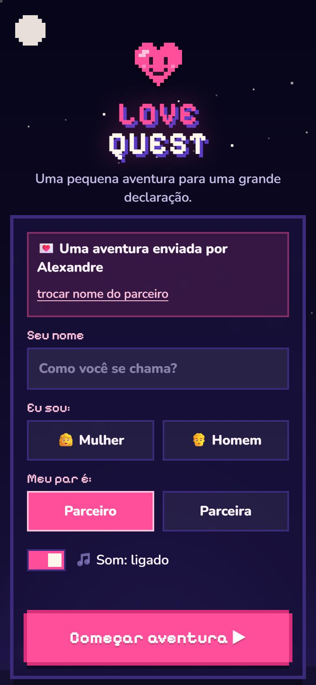
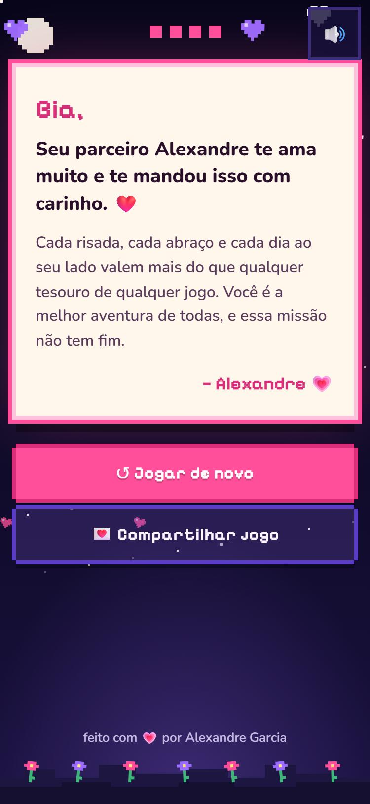

# 💗 LOVE QUEST

### Um jogo para compartilhar com seu amor 💗

> Uma pequena aventura para uma grande declaração.

LOVE QUEST é um jogo de plataforma 2D em pixel art com uma declaração de amor no final. Quem joga precisa resgatar o par, levado pelo **Chefão Tédio** para o Castelo nas Nuvens, atravessando fases com pulos, inimigos, checkpoints e segredos. No caminho, as escolhas negativas existem, mas o jogo nunca deixa você escolhê-las.


<p align="center">
  
  
</p>

## 🗺️ A aventura

| | Fase | Novidade |
|---|---|---|
| 1 | **Céu Estrelado** | Pular, pisar e atirar corações nos Tedinhos, nuvens atravessáveis, Caracol Carteiro |
| 2 | **Jardim Florido** | Asas do Amor (pulo duplo), flores-trampolim, abelhas, plataformas móveis, Coruja Fofoqueira |
| 3 | **Cidade à Noite** | Chegada pelo aeroporto, Saudade Acelerada (impulso no ar, no 3º toque de PULAR), plataformas que caem, pombos burocratas que carimbam, Ponte JK, ipês e o horizonte de Brasília |
| ★ | **Castelo nas Nuvens** | Chefão Tédio em 3 etapas (chuva cinza, investidas, bocejos); arremesse corações com B |

Entre as fases há um **mapa do mundo** (vista de cima) em que o caminho vai se abrindo. Cada fase tem uma **carta secreta** escondida, e cada carta encontrada acrescenta uma frase à mensagem final. Ninguém fica preso: depois de 5 tropeços no mesmo trecho, o mascote oferece o **Modo Carinho** (pulo extra e imunidade). Recusar três vezes… ativa mesmo assim. O progresso fica salvo no próprio aparelho.

## 🎮 Controles

| | Teclado | Controle (Xbox/PS) | Celular |
|---|---|---|---|
| Andar | ← → ou A D | Analógico / direcional | ◀ ▶ (dá para deslizar o dedo) |
| Pular (segure para ir mais alto) | Espaço, ↑, W ou Z | A / ✕ | **A** |
| Atirar corações · conversar com NPC | X, J ou Shift | X / □ | **B** |
| Impulso (Fase 3): no ar, depois do pulo duplo, aperte PULAR de novo | | | **A** |
| Pausar | Esc ou P | Start | ❚❚ |

No celular o jogo abre **deitado**. Se preferir jogar em pé, escolha "Prefiro jogar em pé" ou troque o layout no menu de pausa.

## 💌 Link personalizado

Para mandar o jogo já com o seu nome preenchido, use os parâmetros opcionais:

```
https://SEU-PROJETO.vercel.app/?de=Alexandre&g=m
```

| Parâmetro | Significado |
|---|---|
| `de` | Nome de quem envia. Aparece como "💌 Uma aventura enviada por …", com um botão para trocar. |
| `g` | Gênero de quem envia: `m` (parceiro) ou `f` (parceira). Opcional. |

Sem parâmetros, o link é genérico e qualquer casal pode usar. Nenhum nome é enviado a servidor ou salvo: tudo acontece no navegador.

## 🛠️ Rodando localmente

Requer Node.js 20+.

```bash
npm install
npm run dev      # http://localhost:5173
npm run build    # gera a pasta dist/
npm run preview  # serve o build localmente
```

## 🚀 Deploy na Vercel

O projeto é um site estático (Vite). Com o repositório conectado à Vercel, cada `git push` na `main` publica automaticamente. A Vercel detecta Vite sozinha: comando de build `npm run build`, pasta de saída `dist`.

## 🎨 Personalização

- **Textos e piadas**: todos estão em [`src/content.ts`](src/content.ts).
- **Fases**: [`src/game/levels/`](src/game/levels/). Cada fase é uma lista de chamadas como `b.ground(0, 22)`, `b.cloud(52, 3, 3)`, `b.enemy(42, 2)`.
- **Física do pulo**: [`src/game/config.ts`](src/game/config.ts).
- **Cores**: variáveis CSS no topo de [`src/styles.css`](src/styles.css).
- **Música**: cada ambiente (mapa, céu, jardim, cidade, chefão, final) tem um chiptune gerado em código (Web Audio, sem arquivos). Para usar faixas próprias, coloque `public/music-<tema>.mp3` (ex.: `music-boss.mp3`) ou `public/music.mp3` para todas. Use apenas músicas com licença livre (ex.: CC0).
- **Cartas secretas**: as frases extras ficam em `letterLines` em [`src/content.ts`](src/content.ts).
- **Créditos**: link do rodapé em `content.credits`.

## ♿ Acessibilidade e mobile

- Feito primeiro para celular: botões grandes, nada depende de hover, áreas seguras do iPhone respeitadas.
- Funciona com toque, mouse e teclado (foco visível em todos os controles).
- Respeita `prefers-reduced-motion`.
- O som só começa depois do toque em "Começar aventura", pode ser desligado na entrada e tem um botão 🔊/🔇 fixo.

## 🧱 Stack

- [Vite](https://vite.dev) + [React](https://react.dev) + TypeScript nos menus
- [Phaser 4](https://phaser.io) no jogo (física Arcade, tilemaps), carregado só quando a aventura começa
- Personagens, mascote, Tedinhos e itens em pixel art desenhada em código ([`src/game/sprites.ts`](src/game/sprites.ts))
- Blocos, plataformas e bandeira do pacote [Pixel Platformer](https://kenney.nl/assets/pixel-platformer) da **Kenney** (CC0), em `public/assets/kenney/`
- Fontes [Pixelify Sans](https://fontsource.org/fonts/pixelify-sans) e [Nunito](https://fontsource.org/fonts/nunito) (SIL Open Font License), servidas pelo próprio site
- Sem backend, banco de dados, analytics ou APIs pagas

```
src/
├── content.ts            # todos os textos (menus, diálogos, piadas)
├── audio.ts              # efeitos e música via Web Audio
├── components/game/      # tela do jogo, HUD, controles de toque, menus
├── game/
│   ├── config.ts         # física: velocidade, pulo, gravidade…
│   ├── sprites.ts        # pixel art própria
│   ├── levels/           # fases descritas em código (chão, nuvens, inimigos…)
│   ├── entities/         # personagem, inimigos e plataformas
│   ├── themes.ts         # fundos (céu, jardim, Brasília) e blocos da cidade
│   ├── progress.ts       # salvamento local (localStorage)
│   └── scenes/           # Phaser: carregamento, mapa, fases e chefão
└── scenes/               # entrada e mensagem final (React)
```

## 🙏 Créditos

- Blocos e cenário: [Kenney](https://kenney.nl), pacotes Pixel Platformer e Tiny Town, licença CC0 (veja `public/assets/kenney/*/License.txt`).

## 📄 Licença

[MIT](LICENSE) © Alexandre Garcia

---

Feito com 💗 por [Alexandre Garcia](https://github.com/AlexandreGarciaJr).
